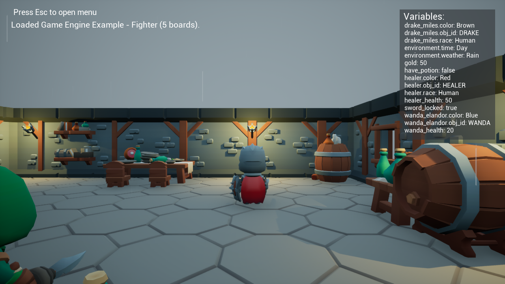

# Arcweave Plugin example project
Unreal 5.6 example of the Arcweave integration, using the same KayKit dungeon, characters and story as the Unity example.

The plugin submodule is pinned to [Arcweave v2.1.0](https://github.com/arcweave/arcweave-unreal-plugin/releases/tag/v2.1.0), including board/component attribute variables and import completion/cancellation callbacks.



See [validation and performance results](Docs/validation.md).

## Project setup

Install Unreal Engine 5.6, Visual Studio 2022 with C++ game development support, and [Git LFS](https://git-lfs.com/). Models and Unreal assets use LFS. If they were cloned as pointer files, run `git lfs pull` before opening the project.
### 1. Clone or Download the Project
Choose **one** of the two methods below to get the project files.

<details>
<summary> Option A: Using Git (Recommended) </summary>
This is the fastest method as it automatically includes the necessary plugin as a submodule. Run the following command in your terminal:

```bash
git lfs install
git clone --recurse-submodules https://github.com/arcweave/arcweave-unreal-example.git
```
</details>

<details>
<summary>Option B: Manual Download (No Git) </summary>
If you prefer not to use Git, you must download the project and the plugin separately:

1. **Download the Project:** [Download Project ZIP](https://github.com/arcweave/arcweave-unreal-example/archive/refs/heads/main.zip) and unzip it.
2. **Download the Plugin:** Download the [Arcweave v2.1.0 source ZIP](https://github.com/arcweave/arcweave-unreal-plugin/archive/refs/tags/v2.1.0.zip). This is the release used by the example.
3. **Install the Plugin:** Create and move the unzipped plugin folder into the project directory at:  
   `ArcweaveDemo/Plugins/Arcweave`

> [!TIP]
> If the `Plugins` folder doesn't exist yet inside `ArcweaveDemo`, simply create a new folder and name it `Plugins`.
</details>

### 2. Build & Launch

1. **Generate Files:** Right-click `ArcweaveDemo.uproject` and choose **Generate Visual Studio project files**.
2. **Prerequisites:** Ensure [Visual Studio 2022](https://www.youtube.com/watch?v=8xJRr6Yr_LU) and its C++ dependencies are installed.
3. **Compile:**
   * Open the `.sln` file.
   * Right-click **Games > ArcweaveDemo** and select **Build**.
4. **Open:** Once the build finishes, close Visual Studio and double-click `ArcweaveDemo.uproject`.

## Git submodule tips
The arcweave plugin is stored in the project as a git submodule

1. Initialization: If you don't see the plugin folder in ArcweaveDemo/Plugins/ folder run ```git submodule update --init --recursive``` to download the plugin files.
2. Detached HEAD: When you enter a submodule, you are usually in a "Detached HEAD" state. If you make changes there, remember to checkout a branch (like main) before committing.

## Playing the example

Open `ArcweaveDemo/ArcweaveDemo.uproject` with Unreal 5.6 and press Play. The bundled JSON loads automatically; no API token is required.

- **WASD / arrow keys:** move.
- **Mouse:** orbit the third-person camera.
- **E:** talk to the nearest character within range.
- **Left click:** choose dialogue options, or attack after Fighter training.
- **Esc:** open the Arcweave import menu.
- **Page Up / Page Down:** browse larger variable lists.

Rendering follows the current window size or the detected fullscreen display size;
no monitor resolution is hardcoded. TAA smooths model edges, and HUD fonts are
rasterized at their displayed size for crisp text in smaller windows too. Windows
high-DPI support is enabled. Saved window settings and Unreal's
`-windowed -ResX=1280 -ResY=720` launch options remain available.

Enter an API token and project hash in the menu, then select **Import from Arcweave**.
Both fields are retained while the game is running, including after closing the
menu or loading the bundled JSON. The token stays masked. Restarting the game
clears these fields; they are not saved in configuration files. Failed imports show
a retry message and preserve the previous project. Starting another import or
loading bundled JSON cancels the pending request.

Help Wanda with the Healer's potion, or train with the Fighter. The variable display, health bars, animations, sounds and potion respond to the story. The Environment component controls Day/Night and Clear/Rain.

The variable panel lists the current imported project's variables and updates as
the story runs. Eligible board and component attributes appear as
`owner_custom_id.attribute_custom_id` (for example, `healer.color`). Importing
another project replaces the list; variables absent from that project are removed.
The panel bounds long values and paginates large lists. Changes to weather, time
and character-color attributes update the scene immediately.

## Implementation

`Content/KayKit/Maps/ArcweaveDemo` is the default map. Runtime code lives in `Source/ArcweaveDemo`:

| Files | Responsibility |
|---|---|
| `KayKitCharacter` | Character, camera and animation |
| `KayKitController` | Input and runtime lifecycle |
| `KayKitStory.cpp` | Story navigation, variable cache and scene attributes |
| `KayKitMenu.cpp` | Import menu, errors and session credentials |
| `KayKitHUD` | Dialogue, portraits, health and variable display |
| `KayKitGameMode` | Default controller and HUD |

Story evaluation, variables and branch conditions are handled by the Arcweave plugin submodule.

The scene uses the Unity example's CC0 KayKit Adventurers and Dungeon Remastered assets. Source files and license notices are in `SourceAssets/KayKit`. The map uses conventional lighting and shadows, with Lumen, virtual shadow maps and mesh distance fields disabled. Only the new map is selected for packaging. The old village, template code and packaged binaries have been removed; the original example remains in Git history.

See [Tools/README.md](Tools/README.md) for source provenance, rebuilding the scene and runtime verification.

## Data Collection Methods
There are two primary methods for collecting data:

**Web API:** This involves fetching data directly from the Arcweave Web API.

**JSON Import:** For this method, you'll need to import a JSON file from your Arcweave project. Ensure that the JSON file, along with all required assets, is placed in the **Content->ArcweaveExport directory**. If this directory does not exist, you will need to create it.
Also make sure you have enabled to receive data from local JSON in UE Settings > Project Settings > Plugins > Arcweave and you have restarted your UE for the setting to take effect.

## Packaging

Package Windows through Unreal's **Platforms > Windows > Package Project** menu, using an output directory outside the repository. Include the project and plugin MIT licenses and the KayKit license notices with distributed builds. Executables, ZIPs, build logs and generated files are excluded from source control.
